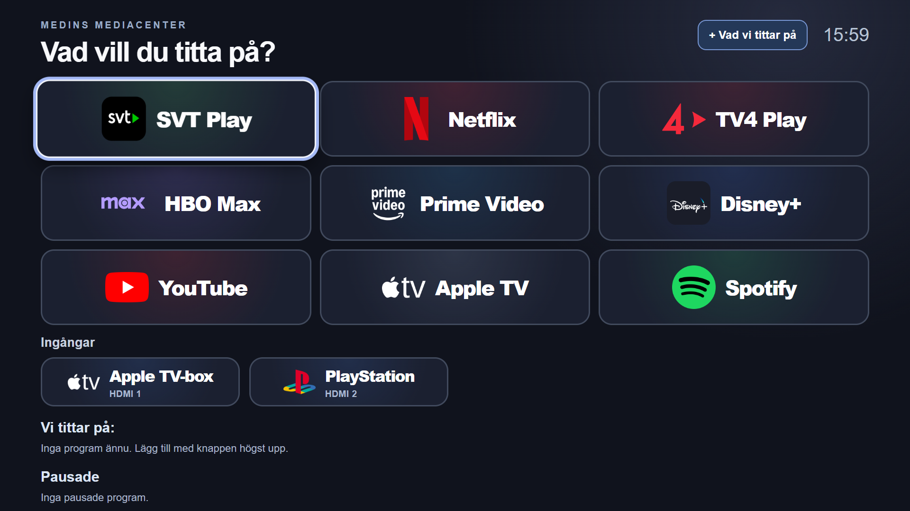

# Medins Mediacenter

En personlig startvy för Samsung Tizen TV med nio appar och två HDMI-ingångar. Den visar bara valen du själv vill ha, utan rekommendationer eller reklambanners. Appen är byggd som en lokal Tizen-webbapp.

## Rutor

SVT Play, Netflix, TV4 Play, HBO Max, Prime Video, Disney+, YouTube, Apple TV och Spotify. **Apple TV-boxen sitter på HDMI 1 och PlayStation på HDMI 2.** Apple TV-rutan bland apparna öppnar Samsungs Apple TV-app; Apple TV-boxen har en egen HDMI-ruta.

Appen hämtar TV:ns lista över installerade appar. Om ett namn inte matchas kan rutan kopplas manuellt till en installerad app. Valet sparas lokalt på TV:n.

SVT Play öppnas via Samsungs HbbTV-motor. Mediacenter läser HbbTV-länken från den installerade appens metadata och skickar rätt startparametrar till motorn. Detta verifierades på TV:n i version 0.5.0. Metoden utgår från [AeroTizens HbbTV-start](https://github.com/helalaou/AeroTizen/blob/main/launcher/js/apps.js); licensinformation finns i [THIRD_PARTY_NOTICES.md](THIRD_PARTY_NOTICES.md).

## Vi tittar på

Knappen **Vad vi tittar på** öppnar ett formulär för programnamn, app och valfritt datum och tid. Datum och tid kan lämnas tomma var för sig. Program med datum sorteras först efter datum och tid; övriga visas därefter. Välj ett program för att öppna dess app, använd pausknappen för att flytta det till **Pausade**, eller krysset för att radera det. I Pausade kan ett program återupptas eller raderas. Listorna sparas lokalt på TV:n. En programrad öppnar appen, inte automatiskt ett visst avsnitt eller en direktsänd kanal inne i appen.

## Bygg och installera

`python build.py` skapar `dist/MedinsMediacenter-0.6.0.wgt`. Paketet är osignerat tills installationsverktyget signerar det. Se [CONNECTIONS.md](CONNECTIONS.md) för TV-anslutning, certifikatplats, installationskommando och hur en uppdatering görs.

Den lokala filen `CONNECTIONS.local.md` sparar Daniels faktiska nätverksadresser och TV-ID. Den och genererade installationspaket är undantagna från Git.

Förhandsgranska genom att öppna `index.html` i en webbläsare. Då visas exempelappar och ingen TV styrs.

## Startanimation

Vid en ny appstart glider MM-loggans fyra rutor ihop, bokstäverna tänds och spelknappen pulserar. Animationen tar ungefär en sekund och kan hoppas över med valfri fjärrkontrollknapp. Den avslutas om appen lämnas och spelas inte upp igen när samma appsession återupptas. Inställningen för minskad rörelse respekteras. Ikonen i Samsungs startmeny är fortfarande en statisk bild.

Öppna [animation-preview.html](animation-preview.html) på datorn för att se animationen. Knappen **Spela igen** startar om förhandsvisningen. Sidan ingår inte i TV-paketet.

## Kända begränsningar

- **Automatisk start vid påslagning** är inte löst. Den här TV:n visar inte inställningen *Starta senaste appen*. En installerad Tizen-app kan inte själv ersätta Samsungs systemstartvy. SmartThings-rutin som öppnar appen är en möjlig väg att pröva, men den är inte verifierad på denna TV.
- Tizen-TV-appar ritas i **1920 × 1080 logiska pixlar** och skalas upp av TV:n även på en 4K-panel. Logotyperna är högupplösta PNG-filer; appen kan inte ändra TV:ns systemupplösning.

## Filer

- `app.js`: appar, HDMI-ingångar, fjärrkontroll och startlogik.
- `styles.css`: rutnätets utseende.
- `config.xml`: namn, version, ID och Tizen-behörigheter.
- `make_icon.py`: genererar MM-ikonen i högupplöst `icon.png` och TV:ns utvecklarikon `launcher-mm.png` (117 × 117 pixlar).
- `assets/logos/`: lokala app- och enhetslogotyper. Källor: [Dashboard Icons](https://github.com/homarr-labs/dashboard-icons) och [Simple Icons](https://github.com/simple-icons/simple-icons). Varumärkena tillhör respektive ägare.

För ändringar: höj versionen i `config.xml`, kör `python build.py`, installera det nya paketet och testa på TV:n. Behåll `NQLEDHOME1.Home` och `NQLEDHOME1` om installationen ska uppdatera samma app och behålla lokala appkopplingar.
